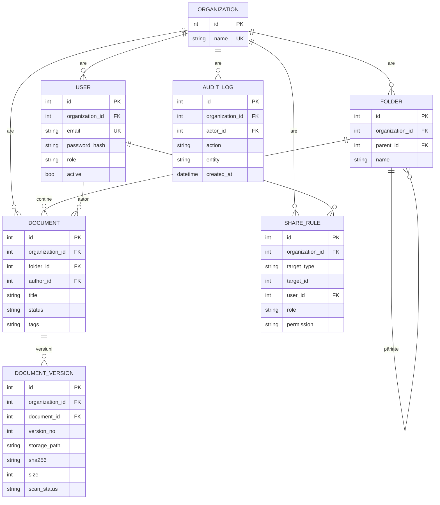

# Arhitectură

## 1. Schiță
```
[React + Vite SPA] --fetch/JSON--> [Express REST API] --Sequelize--> [SQLite]
                                        |                               |
                                        |                               +-- FTS5 (căutare, filtrată pe org)
                                        +--> [Scanner antivirus simulat (serviciu extern local)]
                                        +--> [Stocare fișiere pe disc: storage/<orgId>/<docId>/<versiune>]
```
Straturi backend: `routes → middleware (auth, tenant, validare) → services (reguli de business) → repositories (acces tenant-scoped) → modele Sequelize`.

## 2. Schema de date (ER)


Constrângeri cheie:
- Toate tabelele de domeniu au `organization_id NOT NULL`.
- Cheie unică `(organization_id, id)` pe fiecare tabelă părinte; relațiile copil folosesc FK compuse `(organization_id, parent_id) → (organization_id, id)`, deci o referință între organizații este imposibilă și la nivel de BD (I2).
- `UNIQUE(document_id, version_no)`; `CHECK(status IN (...))`; `CHECK(role IN ('ORG_ADMIN','MEMBER'))`; `UNIQUE(organization_id, email)` sau email global unic.
- Index `(organization_id, folder_id)`, `(organization_id, status)`, `(organization_id, created_at)`.
- SQLite: `PRAGMA foreign_keys = ON` obligatoriu.

## 3. API REST (v1)
Convenții: JSON, prefix `/api`, autentificare cu token în cookie `HttpOnly`/`SameSite` sau Bearer, `organizationId` **nu** vine din client ci din token. Eroare: `{ "error": { "code", "message", "details" } }`.

| Metodă | Cale | Rol | Descriere | Erori principale |
|---|---|---|---|---|
| GET | `/api/health` | public | stare serviciu | – |
| POST | `/api/auth/login` | public | autentificare | 400, 401, 429 |
| POST | `/api/auth/logout` | autentificat | | 401 |
| GET | `/api/me` | autentificat | profil + rol | 401 |
| GET/POST | `/api/users` | ADMIN | listă/creare membri | 400, 403, 409 |
| PATCH | `/api/users/:id` | ADMIN | rol/activ | 403, 404, 409 (ultimul admin) |
| GET | `/api/folders` | autentificat | arbore vizibil | 401 |
| POST | `/api/folders` | ADMIN | creare folder | 400, 403 |
| PATCH/DELETE | `/api/folders/:id` | ADMIN | redenumire/ștergere | 403, 404, 409 |
| GET | `/api/documents` | autentificat | listă cu `folderId,status,tag,authorId,q,sort,page,pageSize` | 400 |
| POST | `/api/documents` | MEMBER+ | creare document + v1 (multipart) | 400, 403, 413, 415, 422 |
| GET | `/api/documents/:id` | cu drept READ | metadate | 403/404 |
| PATCH | `/api/documents/:id` | autor/WRITE/ADMIN | metadate | 403, 404, 409 |
| POST | `/api/documents/:id/versions` | WRITE | versiune nouă | 409 (status APPROVED), 413, 415, 422 |
| GET | `/api/documents/:id/versions` | READ | istoric | 403/404 |
| GET | `/api/documents/:id/versions/:n/download` | READ | descărcare | 403/404 |
| POST | `/api/documents/:id/transitions` | autor/ADMIN | `{ to, reason }` | 403, 409 |
| GET | `/api/search?q=&page=&pageSize=` | autentificat | căutare | 400 |
| GET/POST/DELETE | `/api/documents/:id/shares` | ADMIN/autor | reguli partajare | 400, 403, 404 |
| POST | `/api/exports` | ADMIN | export ZIP al organizației | 403 |
| GET | `/api/audit` | ADMIN | jurnal | 403 |

Regulă: accesul la un obiect din altă organizație întoarce **404** (nu 403), ca să nu confirme existența.

## 4. Decizii de autorizare
Ordine: autentificare → rezolvare `organizationId` din token → rol → drept pe obiect (autor / partajare) → acțiune. Totul se evaluează la fiecare cerere (I3). Un singur modul `policy` centralizează deciziile, folosit și de căutare și de export.

## 5. Serviciu extern
Scanner de fișiere simulat local (`POST /scan` → `{ verdict: clean|infected|error }`), cu contract documentat și scenarii: răspuns lent (timeout), eroare 5xx (retry + stare `scan_pending`), fișier de test „infectat”. Cost zero.

## 6. Pachete arhitecturale
Detalii și ADR: `docs/packages/ten.md`, `docs/packages/sec.md`, `docs/adr/`.
